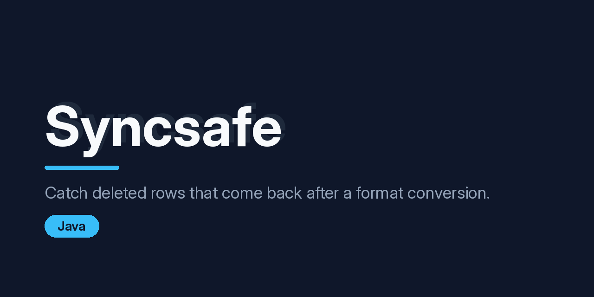
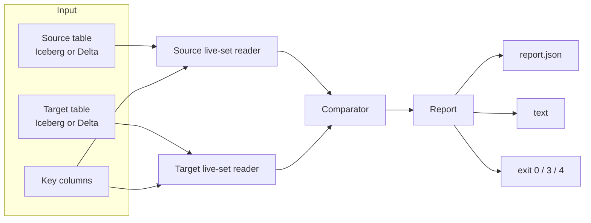

# Syncsafe



**Compare the live row set of two lakehouse tables after a metadata conversion, and fail CI when deleted rows come back.**

[](https://github.com/Faridkosarifard/syncsafe/actions/workflows/ci.yml)


## Why

Metadata converters such as [Apache XTable](https://xtable.apache.org/) and [Delta UniForm](https://docs.delta.io/delta-uniform/) let you write a table in one format and expose it as another without copying Parquet files. Row-level deletes are the sharp edge of that promise.

Apache XTable does not yet translate deletion vectors. The project's tracking issue, [incubator-xtable#339](https://github.com/apache/incubator-xtable/issues/339) (still open, last updated 19 November 2026), describes incomplete translation and incorrect results when delete files are dropped. A reproduction posted on that issue against `main` (`e91662f`, Spark 3.4.2, Delta 2.4.0, Iceberg 1.9.2) is concrete: a Delta table with 1000 rows, then `DELETE WHERE id < 100`, is read as 900 rows by Delta and as 1000 rows by Iceberg after incremental and full syncs, all of which report `SUCCESS`. Only `OPTIMIZE` or `REORG PURGE` close the gap, because they rewrite the data files. XTable's own [RFC-2](https://github.com/apache/incubator-xtable/blob/main/rfc/rfc-2/2%20-%20Deletion%20Info%20Conversion.md) states the same historical behaviour: *before* deletion-vector conversion, "delete vectors were ignored and would cause incorrect results in the target table."

Delta UniForm takes a different path, with its own limits:

- [UniForm](https://docs.delta.io/delta-uniform/) and Databricks' [Iceberg reads](https://docs.databricks.com/aws/en/delta/iceberg-reads) for `IcebergCompatV2` do not work on tables that have deletion vectors enabled. Enabling UniForm on such a table requires `REORG` to purge the vectors first. Iceberg v2 readers cannot consume deletion vectors; Iceberg v3 can.
- Delta Lake 4.3 (June 2026) added experimental [`IcebergCompatV3`](https://delta.io/blog/2026-06-22-delta-4-3-release/), which *does* allow deletion vectors and UniForm to coexist. In that release, UniForm writes Iceberg `DataFile.recordCount` as the **physical** (pre-vector) count, not the logical one. Tooling that treats `recordCount` as a live count will be wrong.

Syncsafe does not run XTable or UniForm. It reads both sides itself, applies deletes, and reports whether the live rows agree.

## What it does

- **Reads** an Iceberg table (format v2 position and equality deletes, via the Iceberg Java API and a directory-based Hadoop catalog) and a Delta table (deletion vectors, via Delta Kernel).
- **Computes** the live key multiset on each side for a chosen snapshot or version, and also records the physical (pre-delete) row count.
- **Reports** `resurrected` keys (live on the target, gone on the source), `missing` keys, and `count_mismatch` keys, as JSON (schema 1.0) and as text.
- **Exits** `0` when the sides agree, `3` when they diverge, and `4` when a side could not be read completely, so a pipeline can fail closed.

## Architecture



## Quickstart

```bash
# JDK 17 or newer. The Maven Wrapper downloads Maven itself.
./mvnw -DskipTests package
alias syncsafe='java -jar target/syncsafe-0.1.0-all.jar'

# Build an aligned pair and a pair that drops deletion vectors, then verify both.
syncsafe demo --dir /tmp/syncsafe-demo

# Re-run the diverged case yourself (exit 3, resurrected keys).
syncsafe verify \
  --source delta:/tmp/syncsafe-demo/diverged/source-delta \
  --target iceberg:/tmp/syncsafe-demo/diverged/target-iceberg \
  --keys id \
  --json-out report.json --text-out report.txt
echo "exit code: $?"   # 0 aligned, 3 diverged, 4 incomplete

syncsafe report report.json
```

`--source` and `--target` are `format:path` values. The path is the table directory (`HadoopTables` for Iceberg, `Table.forPath` for Delta). Optional `--source-snapshot` / `--target-snapshot` pin an Iceberg snapshot; `--source-version` / `--target-version` pin a Delta version.

### As a library

```java
import io.github.faridkosarifard.syncsafe.compare.LiveSetComparator;
import io.github.faridkosarifard.syncsafe.model.TableRef;
import io.github.faridkosarifard.syncsafe.model.VerificationReport;
import io.github.faridkosarifard.syncsafe.read.TableReaders;
import java.util.List;

var source = TableReaders.readQuietly(TableRef.parse("delta:/warehouse/orders"), List.of("id"));
var target = TableReaders.readQuietly(TableRef.parse("iceberg:/warehouse/orders"), List.of("id"));
VerificationReport report = LiveSetComparator.compare(source, target);
System.out.println(report.verdict() + " " + report.summaryCounts());
```

## Example report (excerpt)

```json
{
  "schema_version": "1.0",
  "tool": "syncsafe",
  "tool_version": "0.1.0",
  "verdict": "diverged",
  "key_columns": ["id"],
  "source": {
    "format": "delta",
    "location": "file:///tmp/orders-delta",
    "version": 1,
    "live_row_count": 7,
    "physical_row_count": 10,
    "deleted_row_count": 3
  },
  "target": {
    "format": "iceberg",
    "location": "file:///tmp/orders-iceberg",
    "snapshot_id": 5641947432456283286,
    "live_row_count": 10,
    "physical_row_count": 10,
    "deleted_row_count": 0
  },
  "summary": {"resurrected": 3, "missing": 0, "count_mismatch": 0},
  "hint": "Physical row counts match (10) but live counts differ. The target may be missing delete files or deletion vectors, so it is exposing rows the source has already deleted."
}
```

The full schema is documented in [docs/report-format.rst](docs/report-format.rst). How each reader applies deletes is in [docs/live-sets.rst](docs/live-sets.rst).

## Limitations

- **Iceberg and Delta only.** Apache Hudi is out of scope in this release.
- **Local filesystem tables.** The readers use Hadoop `file://` I/O. Object-store catalogs (S3, Glue, REST, Unity Catalog) are not wired up yet.
- **Partition columns** that are not materialized in the Parquet files cannot be used as keys on the Delta side. Unpartitioned tables, and tables that write partition values into the files, work.
- **Delta column mapping** (`delta.columnMapping.mode` `name` or `id`, which UniForm requires) is not supported yet; such tables are reported as incomplete (exit 4).
- **Iceberg v2** position and equality deletes are covered by tests. Iceberg v3 deletion vectors are applied only to the extent `IcebergGenerics` already does so; this release does not ship a v3 fixture.
- **One snapshot or version per side.** Syncsafe does not walk history, orphan files or object versions (see [Afterimage](https://github.com/Faridkosarifard/afterimage) for Iceberg residue after a `DELETE`).
- **Report JSON:** non-integer timestamp keys (Iceberg `timestamp_ns` values with a sub-microsecond part) are written as strings in `key_values`, so parsers that use IEEE doubles keep the exact value.
- **Scale:** every live row is keyed in memory. That is enough for CI fixture tables and modest production checks; very large tables need a later, spill-to-disk path.
- Syncsafe **does not convert, compact or rewrite** a table. It only reports whether the two live sets agree.

## Roadmap

- Apache Hudi live-set reads (timeline, log blocks).
- Catalog connections (Iceberg REST, Hive, Glue; Delta / Unity Catalog).
- Object-store file I/O (S3, GCS, ADLS).
- First-class Iceberg v3 deletion-vector fixtures.
- A streaming comparison that does not hold every key in memory.

## Development

```bash
make check     # Spotless, Checkstyle, tests, JaCoCo gates
make format    # apply Google Java Format
make package   # shaded CLI jar
make demo      # fixture walkthrough (no Docker)
```

See [CONTRIBUTING.rst](CONTRIBUTING.rst) for the workflow and [CHANGELOG.rst](CHANGELOG.rst) for releases.

## License

Apache License 2.0. See [LICENSE](LICENSE).
